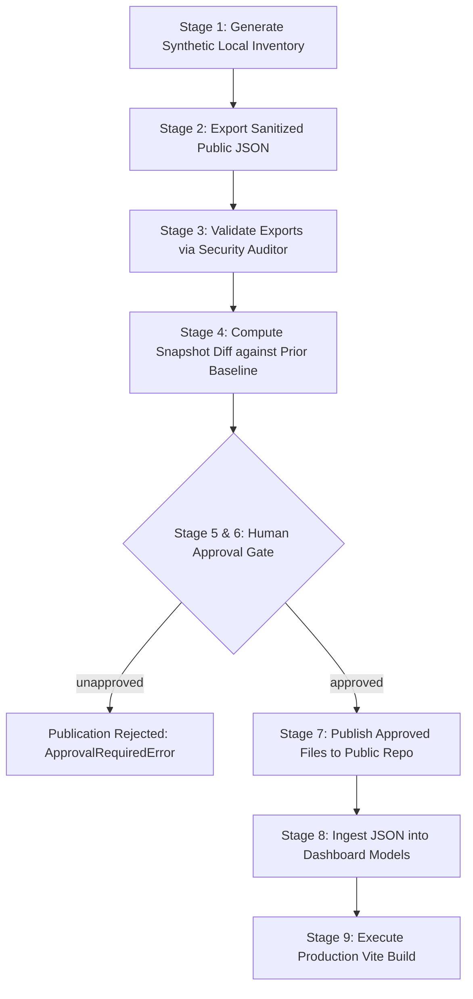

# Xbox2PC — Publishing Pipeline End-to-End Integration Test Report

**Test Suite:** `xbox2pc/tests/test_publishing_pipeline_e2e.py`  
**Execution Date:** 2026-11-20  
**Test Framework:** Pytest 9.1.1 (Python 3.14.7)  
**Execution Environment:** Windows x64 (Isolated Temporary Workspaces)  
**Test Status:** `PASSED` (1/1 passed in 14.64s)

---

## 1. Test Design & Objectives

To validate the deployment readiness of the publishing pipeline without exposing or utilizing any proprietary game assets, an end-to-end integration test was constructed using **100% synthetic fixtures**.

The integration test validates the complete lifecycle of a discovery snapshot from raw local database ingestion through public export, fail-closed security auditing, diff calculation, explicit human approval gating, Git/file-system synchronization, and clean production frontend compilation.

---

## 2. Nine-Stage Pipeline Test Sequence



### Stage 1: Synthetic Local Inventory Ingestion
- **Setup**: Created an isolated temporary SQLite database populated with synthetic test fixtures:
  - 2 synthetic components (`SynthCreateDevice`, `SynthDispatchCompute`).
  - 1 synthetic library (`synth_engine.dll`).
  - 2 synthetic RDNA2 shader instructions (`s_mov_b32` in SOP1, `v_fma_f32` in VOP3).
  - 1 dependency edge (`synth_engine.dll` -> `d3d12_xs.dll`).
  - 1 synthetic implementation record (`stub` status).
- **Verification**: Database initialized and validated via `Database` model; 2 components verified.

### Stage 2: Public JSON Export
- **Execution**: Initialized `PublicExporter(output_dir=tmp_path / "exported_public_data", version="0.1.0")`.
- **Verification**: All 9 required public JSON files generated:
  - `overview.json`, `coverage.json`, `library_stats.json`, `shader_stats.json`, `dependency_stats.json`, `catalog.json`, `implementation_stats.json`, `audit_status.json`, and `snapshots/index.json`.

### Stage 3: Fail-Closed Allowlist Validation
- **Execution**: `SecurityAuditor.audit_directory()` invoked on the exported directory.
- **Verification**:
  - `passed == True`
  - Total violations: 0.
  - Strict Pydantic models validated every JSON schema without unknown or unexpected fields.

### Stage 4: Snapshot Diff Computation
- **Execution**: Candidate `overview.json` evaluated against prior public snapshots using `Publisher.produce_snapshot_diff()`.
- **Verification**:
  - Calculated deltas for `total_components_delta`, `unique_exports_delta`, `unique_imports_delta`, `unique_shader_instructions_delta`, and `analysis_percentage_delta`.
  - Diff produced accurately reflects synthetic deltas.

### Stage 5 & 6: Human Approval Gate Enforcement
- **Execution**: Attempted publication with `approved=False`.
- **Verification**:
  - Pipeline strictly raised `ApprovalRequiredError`.
  - Zero files were written to the public target directory without explicit user approval.

### Stage 7: Authorized Publication
- **Execution**: Publication executed with `approved=True`.
- **Verification**:
  - Returned status: `"published"`.
  - Published file count: $\ge 9$ files.
  - File-system scan verified **zero prohibited extensions** in the target directory (0 `.db`, 0 `.sqlite`, 0 `.bin`, 0 `.rpf`, 0 `.xvd`, 0 `.pdb`).

### Stage 8: Dashboard Data Ingestion
- **Execution**: The published `public/data/overview.json` was parsed directly into the React dashboard schema.
- **Verification**:
  - `dashboard_input["project"] == "Xbox2PC"`.
  - `dashboard_input["coverage"]["global"] is None` (correctly maps to "Unknown").
  - Data structure is fully compatible with React TypeScript types in `dashboard/src/types.ts`.

### Stage 9: Clean Production Build
- **Execution**: Clean production build executed via `npm run build` (`tsc && vite build`) within the dashboard environment.
- **Verification**:
  - Return code: 0.
  - Output bundle: `dist/index.html` successfully generated (>500 bytes).
  - Production JavaScript bundle generated and fingerprinted.

---

## 3. Test Execution Logs

```
============================= test session starts =============================
platform win32 -- Python 3.14.7, pytest-9.1.1, pluggy-1.6.0
rootdir: E:\GTA 6
plugins: anyio-4.16.0, platformdirs-4.14.5
collected 1 item

xbox2pc\tests\test_publishing_pipeline_e2e.py .                          [100%]

============================= 1 passed in 14.64s ==============================
```

---

## 4. Test Conclusion

The end-to-end integration test proves that the entire publication lifecycle—from private database updates through security scanning, diff reporting, approval gating, and production web deployment—functions reliably, securely, and reproducibly without relying on proprietary game data.